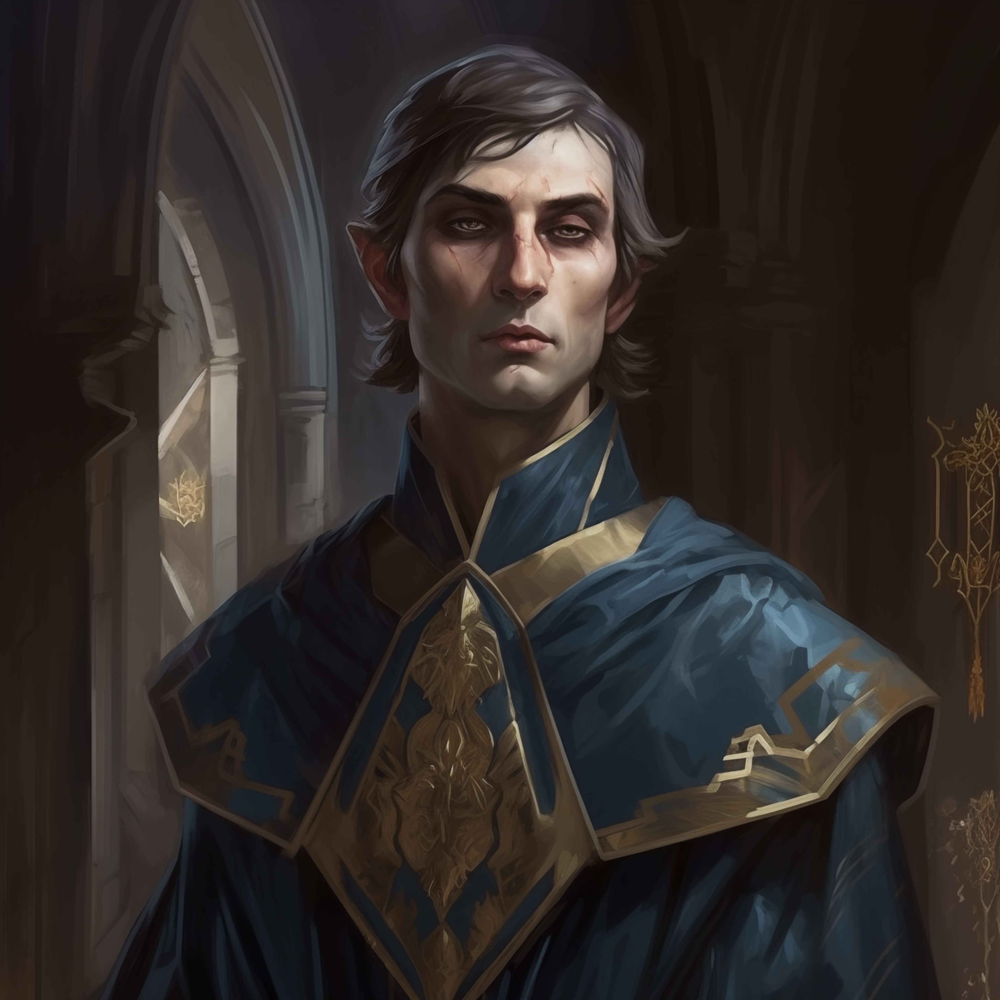

# Caladrel Ecthëlion

Pathfinder 1e character sheet, copied from Roll20 (sheet v1.303) on 2026-10-23.

## Bio

| Field | Value |
|---|---|
| Player | Sturla |
| Class | Wizard (Conjurer / Handanvaldur) 7 |
| Race | Elf |
| Alignment | Lawful Good |
| Size | Medium |
| Gender | M |
| Age | 85 |
| Height | 6 ft. 2 in. |
| Weight | 140 |
| Hair | Dark-Silver-Grey |
| Eyes | Dark-Blue |
| Deity | — |
| Homeland | — |
| XP | 23,000 (next level 35,000, medium track) |

## Backstory

Beneath the unwavering gaze of a full moon, I drew my first breath. Crystalline spires, rising defiantly from the desert's embrace, bore silent witness. Here, in this city of mirrors and secrets, my destiny was etched.

While others sought solace in fleeting moments of joy, my days were claimed by ancient knowledge and relentless discipline. Tutors, their eyes heavy with the burdens of lost realms, schooled me in the shadows and wonders lurking just beyond the veil of reality. And while children danced under the moonlight's caress, I wrestled with ethereal forces. I felt an innate potential surging within, a promise that one day, my fingers would weave patterns powerful enough to challenge and reshape the very fabric of existence.

The legacy of the Ecthëlions whispered its weighty expectations, an ever-present echo in my every step. Though born of noble blood, the warmth of my parents' embrace was a tale I knew only from secondhand whispers. Their lives, so intertwined with the affairs of realms and realities beyond, left little room for the son who walked among them.

In the heart of this maze of reflections, surrounded by the weight of ancient legacies, my resolve was forged. The arcane became more than just gestures and incantations; it was the very essence of my being. To many, my words seemed ensnared in cryptic mysteries, but to me, they were the desperate utterances of one who has peered into the abyss and felt its chilling stare in return.

As night's mantle enveloped the city, I felt the pull of a deeper, darker purpose. Beneath the very stars that witnessed my birth, a burning resolve kindled. I would harness the boundless powers of the cosmos, pit ancient evil against eldritch horrors, and in the crucible of that apocalyptic clash, eradicate the scourge of malevolence. For within the vast expanse of the universe's enigmas, one truth was irrefutable: I was destined to be its instrument of reckoning.

## Ability scores

| Ability | Base | Current | Mod | Temp |
|---|---|---|---|---|
| STR | 7 | 7 | -2 | 0 |
| DEX | 16 | 18 | +4 | 0 |
| CON | 14 | 12 | +1 | 0 |
| INT | 18 | 22 | +6 | 2 |
| WIS | 10 | 10 | 0 | 0 |
| CHA | 7 | 7 | -2 | 0 |

Racial modifiers (Elf): DEX +2, CON -2, INT +2. INT temp +2 is the Headband of Vast Intelligence.

## Combat

| Stat | Value |
|---|---|
| HP | 40 / 40 (temp 0, nonlethal 0) |
| Hit die | d6 |
| Initiative | +10 |
| AC | 15 |
| Touch AC | 14 |
| Flat-footed AC | 11 |
| Fortitude | +5 |
| Reflex | +8 |
| Will | +7 |
| BAB | +3 |
| CMB | +1 |
| Melee attack | +1 |
| Ranged attack | +7 |
| CMD | 15 |
| Spell resistance | 0 |
| Speed | 30 ft. land, 120 ft. run, 5 ft. swim, 5 ft. climb |

Class base: BAB 3, Fort 2, Ref 2, Will 5. Skill ranks: (2 + 6 INT) × 7 = 56.

Weapons: Dagger (melee), Light Crossbow (ranged) with 5 bolts (ranged ammo field shows 20).

AC items: Amulet of Natural Armor (+1 natural).

Senses: Low-Light Vision.

Languages: Common, Elven, Draconic, Celestial, Orc, Sylvan, Infernal. Learning (need teacher): Giant, Ancient Dwarven.

## Skills

Skill names were missing from the paste; they are reconstructed from the sheet's standard skill order and checked against the 56/56 rank total. Class skills include the +3 class bonus in the total.

| Skill | Total | Ability | Ranks | Misc |
|---|---|---|---|---|
| Acrobatics | 4 | 4 | 0 | 0 |
| Appraise | 10 | 6 | 1 | 0 |
| Bluff | 1 | -2 | 3 | 0 |
| Climb | -2 | -2 | 0 | 0 |
| Craft (Alchemy) | 10 | 6 | 1 | 0 |
| Craft (Calligraphy) | 10 | 6 | 1 | 0 |
| Craft (Cartography) | 10 | 6 | 1 | 0 |
| Diplomacy | 2 | -2 | 4 | 0 |
| Disable Device | 4 | 4 | 0 | 0 |
| Disguise | -2 | -2 | 0 | 0 |
| Escape Artist | 4 | 4 | 0 | 0 |
| Fly | 8 | 4 | 1 | 0 |
| Handle Animal | -2 | -2 | 0 | 0 |
| Heal | 0 | 0 | 0 | 0 |
| Intimidate | 2 | -2 | 4 | 0 |
| Knowledge (Arcana) | 16 | 6 | 7 | 0 |
| Knowledge (Dungeoneering) | 11 | 6 | 2 | 0 |
| Knowledge (Engineering) | 11 | 6 | 2 | 0 |
| Knowledge (Geography) | 11 | 6 | 2 | 0 |
| Knowledge (History) | 10 | 6 | 1 | 0 |
| Knowledge (Local) | 10 | 6 | 1 | 0 |
| Knowledge (Nature) | 10 | 6 | 1 | 0 |
| Knowledge (Nobility) | 10 | 6 | 1 | 0 |
| Knowledge (Planes) | 14 | 6 | 5 | 0 |
| Knowledge (Religion) | 11 | 6 | 2 | 0 |
| Linguistics | 12 | 6 | 3 | 0 |
| Perception | 7 | 0 | 7 | 0 |
| Perform | -2 | -2 | 0 | 0 |
| Profession | 0 | 0 | 0 | 0 |
| Ride | 4 | 4 | 0 | 0 |
| Sense Motive | 2 | 0 | 2 | 0 |
| Sleight of Hand | 5 | 4 | 1 | 0 |
| Spellcraft | 16 | 6 | 1 | 6 |
| Stealth | 4 | 4 | 0 | 0 |
| Survival | 1 | 0 | 1 | 0 |
| Swim | -1 | -2 | 1 | 0 |
| Use Magic Device | -2 | -2 | 0 | 0 |

Total ranks: 56 / 56.

## Spellcasting

- Caster level 7, Intelligence (mod +6)
- Concentration: +13 (caster level 7 + Int 6); +17 when casting defensively or grappled (Combat Casting). Ruthol casting-defensively DC: 15 + 2 × spell level + (highest threatening BAB − 10, min 0) + 2 per extra threatening enemy.
- Main school: Conjuration (Teleportation subschool). One extra conjuration slot per level, 1st to 4th.
- Opposed schools: Enchantment, Divination (each costs two slots to prepare)
- Metamagic: Lesser Extend Metamagic Rod (3/day)

| Spell level | Per day | DC | Conjuration DC |
|---|---|---|---|
| 0 | 4 | 16 | 18 |
| 1 | 7 | 17 | 19 |
| 2 | 6 | 18 | 20 |
| 3 | 4 | 19 | 21 |
| 4 | 3 | 20 | 22 |

4th-level slots: Roll20 shows 2. Wizard 7 with Int 22 gets 1 + 1 (bonus) + 1 (school) = 3.

Spellbook: 108 spells (31 cantrips, 27 first, 24 second, 24 third, 2 fourth), kept in [pathfinder_spells](https://sturlabragason.github.io/pathfinder_spells/caladrel_ecthelion/). The two free spells for level 7 are Black Tentacles and Summon Monster IV. The two free spells for level 6 are Sleet Storm and Ablative Barrier (Ablative Barrier added 2026-10-31).

## Feats and features

Feats:
- Spell Focus (Conjuration), bonus feat from Overwhelming Magic
- Greater Spell Focus (Conjuration)
- Improved Initiative
- Combat Casting
- Eschew Materials
- Scribe Scroll (wizard bonus feat)
- Augment Summoning (level 7): creatures you summon get +4 enhancement to Strength and Constitution

Traits and race:
- Warrior of Old: +2 trait bonus on initiative.
- Moonkissed: +1 racial bonus on all saving throws; replaces elven immunities and keen senses. The Roll20 save totals do not include it (would be Fort +6, Ref +9, Will +8).
- Overwhelming Magic: Spell Focus as a bonus feat; replaces elven magic and weapon familiarity.
- Low-light vision.

Class features:
- Shift (Su), Teleportation subschool, replaces Acid Dart: swift action, teleport 15 ft, 9/day (3 + Int).
- Summoner's Charm (Su), always on: conjuration (summoning) spells last 3 rounds longer (1/2 wizard level). Not doubled by Extend Spell.
- Arcane bond: Ring of Pengolodh, 1/day.
- Master of Pentacles (faction trait), 1/day: when casting a conjuration spell, treat caster level as 2 higher for its duration.

## Equipment

Money: 14 GP (0 CP, 0 SP, 0 PP).

| Item | Qty | Weight |
|---|---|---|
| Headband of Vast Intelligence | 1 | 1 |
| Lesser Extend Metamagic Rod | 1 | 0 |
| Dagger | 1 | 1 |
| Spellbook, Wizard's | 1 | 3 |
| Spellbook, Wizard's (second) | 1 | 0 |
| Spell Component Pouch | 1 | 2 |
| Ecthëlion Signet Ring | 1 | 0 |
| Scholar's Outfit | 1 | 6 |
| Pouch, belt | 1 | 0.5 |
| Case, Scroll | 3 | 1.5 |
| Bandolier | 1 | 0 |
| Ring of Pengolodh (bonded object) | 1 | 0 |
| Blank scrolls | 8 | 0 |
| Library card | 1 | 0 |
| Crossbow, Light | 1 | 4 |
| Bolts | 5 | 0.5 |
| Maps | 1 | 0 |
| Notes | 1 | 0 |
| Wand of Detect Magic (charges) | 19 | 0 |
| Amulet of Natural Armor (+1) | 1 | 0 |
| Gloves of Arrow Snaring | 1 | 0 |
| Rauð skikkja með logandi öxi (Cloak of Resistance +2) | 1 | 0 |
| Ice-salamander tongue | 3 | 0 |
| Ancient Dwarven text | 1 | 0 |
| Unidentified scroll | 1 | 0 |

Scrolls (1 each): Obscuring Mist, Bull's Strength, Swift Girding, Knock, Feather Fall, Illusion of Calm, Protection from Evil, Mudball, False Life, Mount, Fog Cloud, See Invisibility. Scroll of Fire Breath: 0 left.

Total weight 19.5 lb + 0.3 coins (light load). Loads: light 23, medium 46, heavy 70. Lift over head 70, lift off ground 140, drag/push 350.

## Player notes

### To buy

- Miniature shovel, 10 gp: focus for Create Pit (Eschew Materials doesn't cover foci).

## Notes (from the sheet, kept as written)

### Family and contacts

- Father: Ægnor Ecthëlion
- Mother: Tuilë Ecthëlion
- Paternal grandfather: Beren Ecthëlion
- Wizard master in Horeck: Haruuv
- Chief of the library in Horeck: Elísen Venra
- Leynireglutengiliður: Alicia
- Lathander hof: Valeska Evergreen
- Safana: Rauð EldSeiðkona / kveikir í hlutum / eldörvar

### Regla Rauða Riddarans

- Sahdina: organizer
- Ulgrim: hátt settur / fær / gera það sem þarf að gera / bogi
- Tarvic: meðlimur / gera það sem þarf að gera / melee
- Aðrir: Styrmir, Ormur (scouts)
- Páll: fær með handaxir (dáinn)
- Jón: með langsverð / lásbogi (dáinn)

Freelance Rauði Riddarinn:

- Ormur: fær með boga, skáti
- Styrmir: ekki ferskur

### Leyniregla Áttavitans

- "Það lítur út fyrir að það ætli að rigna í kvöld"
- Ákveðin týpa af drykkjum
- Áttaviti
- Óvinir reglunnar

### Staðir

- Ruthol
- Korras: höfuðborg
- Ragholt: námubær
- Horeck: galdraborg
  - Torven Windborrow (bæjarstjóri): B Caravan
  - Jane: noblewoman
  - Kuldo: kynntur fyrir okkur
- Vekk: hafnarborg í vestri
- Fjöll hjá Horeck: risar, drekar, fleiri óvættir
- Nanfort að "Lake": óþekkt, fen, hættulegt. Kentárar, tröll, wyverns, bugbears.
- Skull Island: eitthvað við eyjuna sem tengist gamla heiminum! Artifact eða eitthvað annað. Óljóst.

### Úr tröllahelli

- Töframerki
- Lítil sýni af sveppum og mosa

### Ný vagnlest

- Larúka: stjóri
- Halon
- Aeslin
- Nokkrir málaliðar

### Annað

- Bernharð: fjallamaður
- Dagur 13: frá Ruthol
- Tristar: æðstiprestur Lathanders, klaustur í Ruthol
